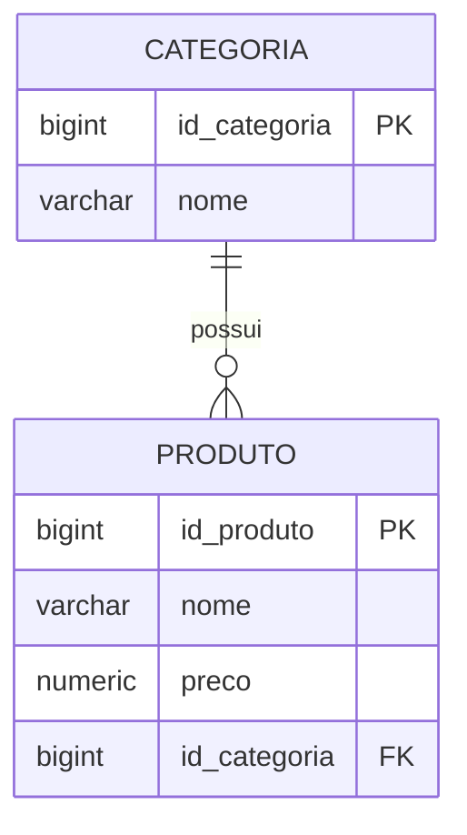
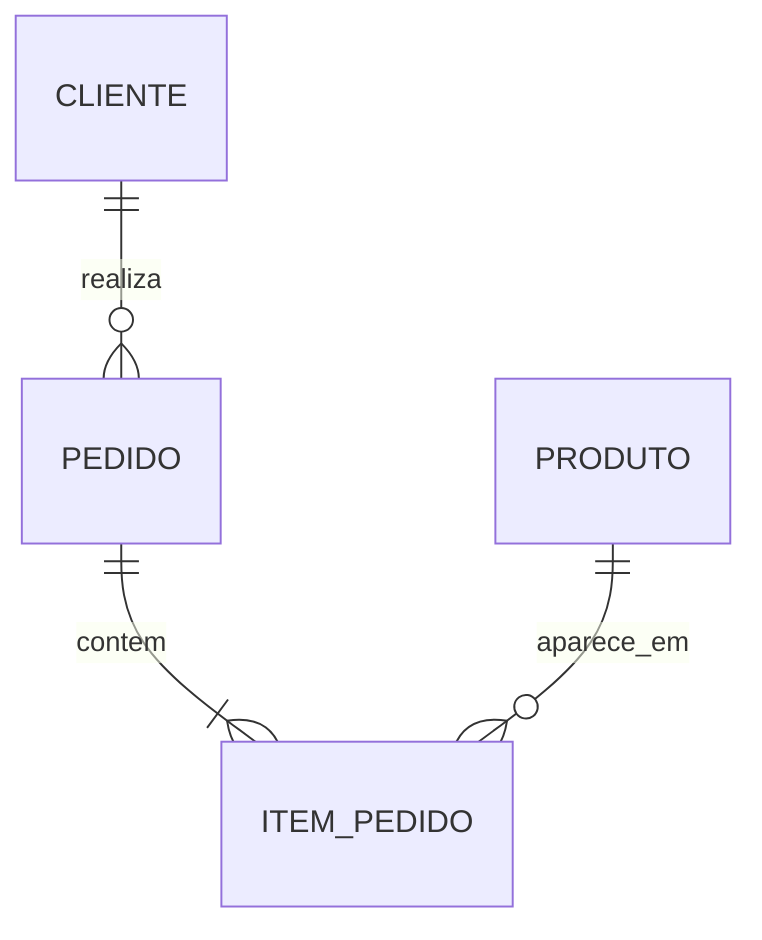

# Aula — Relacionamentos e JOIN no PostgreSQL

## Parte 1 — Recuperando os conceitos anteriores

### 1. Por que precisamos de JOIN?

Durante o estudo da normalização, aprendemos que informações de entidades diferentes devem ser organizadas em tabelas próprias. Considere uma loja com duas entidades:

- `CATEGORIA`: armazena informações sobre categorias.
- `PRODUTO`: armazena informações sobre produtos.

Uma categoria pode possuir vários produtos, enquanto cada produto pertence a uma categoria.

```text
CATEGORIA(
    id_categoria PK,
    nome
)

PRODUTO(
    id_produto PK,
    nome,
    preco,
    id_categoria FK -> CATEGORIA.id_categoria
)
```



Essa estrutura reduz a redundância, mas cria uma necessidade: como consultar o nome do produto e o nome de sua categoria na mesma resposta? O `JOIN` resolve esse problema.

### 2. Dados armazenados separadamente

**Tabela `categoria`**

| id_categoria | nome |
|---:|---|
| 1 | Informática |
| 2 | Móveis |
| 3 | Papelaria |
| 4 | Limpeza |

**Tabela `produto`**

| id_produto | nome | preco | id_categoria |
|---:|---|---:|---:|
| 1 | Notebook | 3500,00 | 1 |
| 2 | Mouse | 80,00 | 1 |
| 3 | Mesa | 900,00 | 2 |
| 4 | Cadeira | 600,00 | 2 |
| 5 | Caneta | 5,00 | 3 |

`PRODUTO` possui apenas o identificador da categoria. Se executarmos:

```sql
SELECT * FROM produto;
```

não teremos o nome da categoria. Poderíamos consultar cada tabela separadamente, mas precisaríamos relacionar manualmente os resultados. Com `JOIN`, o próprio banco realiza essa associação.

---

## Parte 2 — Preparação do ambiente

### 3. Criando as tabelas

```sql
CREATE TABLE categoria (
    id_categoria BIGINT GENERATED ALWAYS AS IDENTITY PRIMARY KEY,
    nome VARCHAR(100) NOT NULL
);

CREATE TABLE produto (
    id_produto BIGINT GENERATED ALWAYS AS IDENTITY PRIMARY KEY,
    nome VARCHAR(100) NOT NULL,
    preco NUMERIC(10,2) NOT NULL CHECK (preco >= 0),
    id_categoria BIGINT NOT NULL,

    CONSTRAINT fk_produto_categoria
        FOREIGN KEY (id_categoria)
        REFERENCES categoria(id_categoria)
);
```

### 4. Inserindo os dados

```sql
INSERT INTO categoria (nome)
VALUES
('Informática'),
('Móveis'),
('Papelaria'),
('Limpeza');

INSERT INTO produto (nome, preco, id_categoria)
VALUES
('Notebook', 3500.00, 1),
('Mouse', 80.00, 1),
('Mesa', 900.00, 2),
('Cadeira', 600.00, 2),
('Caneta', 5.00, 3);
```

Os identificadores gerados foram considerados de 1 a 4. A categoria Limpeza foi cadastrada sem produtos propositalmente, para demonstrar a diferença entre os tipos de `JOIN`.

---

## Parte 3 — INNER JOIN

### 5. Conceito

O `INNER JOIN` combina registros de duas tabelas quando a condição de relacionamento é satisfeita. No exemplo:

```sql
produto.id_categoria = categoria.id_categoria
```

Estrutura geral:

```sql
SELECT colunas
FROM tabela1
INNER JOIN tabela2
    ON tabela1.chave = tabela2.chave;
```

`ON` define a condição de associação.

### 6. Primeiro exemplo

```sql
SELECT
    produto.nome,
    produto.preco,
    categoria.nome
FROM produto
INNER JOIN categoria
    ON produto.id_categoria = categoria.id_categoria;
```

| nome | preco | nome |
|---|---:|---|
| Notebook | 3500,00 | Informática |
| Mouse | 80,00 | Informática |
| Mesa | 900,00 | Móveis |
| Cadeira | 600,00 | Móveis |
| Caneta | 5,00 | Papelaria |

Existem duas colunas chamadas `nome`. Isso não impede a consulta, mas dificulta a interpretação.

### 7. Identificando colunas com AS

```sql
SELECT
    produto.nome AS produto,
    produto.preco,
    categoria.nome AS categoria
FROM produto
INNER JOIN categoria
    ON produto.id_categoria = categoria.id_categoria;
```

| produto | preco | categoria |
|---|---:|---|
| Notebook | 3500,00 | Informática |
| Mouse | 80,00 | Informática |
| Mesa | 900,00 | Móveis |
| Cadeira | 600,00 | Móveis |
| Caneta | 5,00 | Papelaria |

### 8. Apelidos para tabelas

```sql
SELECT
    p.nome AS produto,
    p.preco,
    c.nome AS categoria
FROM produto AS p
INNER JOIN categoria AS c
    ON p.id_categoria = c.id_categoria;
```

`p` representa `produto` e `c` representa `categoria`. Podemos omitir `AS` na declaração dos apelidos:

```sql
FROM produto p
INNER JOIN categoria c
```

Essa prática é comum em consultas com várias tabelas.

### 9. Representação conceitual

```text
PRODUTO             CATEGORIA
   (        [correspondências]        )
             INNER JOIN
```

São retornadas as combinações de linhas que satisfazem `ON`. A categoria Limpeza não aparece porque não possui produtos associados. Diagramas de conjuntos são apenas uma ilustração: um `JOIN` combina linhas conforme um predicado e pode produzir duplicidades.

---

## Parte 4 — JOIN combinado com WHERE e ORDER BY

### 10. Filtrando registros relacionados

```sql
SELECT
    p.nome AS produto,
    p.preco,
    c.nome AS categoria
FROM produto p
INNER JOIN categoria c
    ON p.id_categoria = c.id_categoria
WHERE c.nome = 'Informática';
```

| produto | preco | categoria |
|---|---:|---|
| Notebook | 3500,00 | Informática |
| Mouse | 80,00 | Informática |

### 11. Múltiplas condições

```sql
SELECT
    p.nome AS produto,
    p.preco,
    c.nome AS categoria
FROM produto p
INNER JOIN categoria c
    ON p.id_categoria = c.id_categoria
WHERE c.nome = 'Informática'
  AND p.preco > 100;
```

Resultado: Notebook.

### 12. Ordenando resultados

```sql
SELECT
    p.nome AS produto,
    p.preco,
    c.nome AS categoria
FROM produto p
INNER JOIN categoria c
    ON p.id_categoria = c.id_categoria
ORDER BY p.preco DESC;
```

O `JOIN` estabelece a associação, o `WHERE` filtra as linhas resultantes e o `ORDER BY` organiza sua apresentação.

---

## Parte 5 — LEFT JOIN

### 13. O problema das categorias sem produtos

Com `INNER JOIN`, a categoria Limpeza não aparece. Para listar todas as categorias, inclusive aquelas que não possuem produtos, utilizamos `LEFT JOIN`.

### 14. Conceito e exemplo

O `LEFT JOIN` retorna todas as linhas da tabela à esquerda e as correspondências da tabela à direita. Sem correspondência, as colunas da direita recebem `NULL`.

```sql
SELECT
    c.nome AS categoria,
    p.nome AS produto
FROM categoria c
LEFT JOIN produto p
    ON c.id_categoria = p.id_categoria
ORDER BY c.nome, p.nome;
```

| categoria | produto |
|---|---|
| Informática | Mouse |
| Informática | Notebook |
| Limpeza | NULL |
| Móveis | Cadeira |
| Móveis | Mesa |
| Papelaria | Caneta |

```text
[ TODAS AS LINHAS DE CATEGORIA ] + [ produtos correspondentes ]
                  LEFT JOIN
```

### 15. Categorias sem produtos

```sql
SELECT c.nome AS categoria
FROM categoria c
LEFT JOIN produto p
    ON c.id_categoria = p.id_categoria
WHERE p.id_produto IS NULL;
```

| categoria |
|---|
| Limpeza |

Esse padrão de antijunção localiza registros sem correspondência: clientes sem pedidos, departamentos sem funcionários ou cursos sem alunos.

---

## Parte 6 — RIGHT JOIN

O `RIGHT JOIN` preserva todas as linhas da tabela à direita.

```sql
SELECT
    c.nome AS categoria,
    p.nome AS produto
FROM produto p
RIGHT JOIN categoria c
    ON p.id_categoria = c.id_categoria;
```

Todas as categorias aparecem. Essa consulta é equivalente ao `LEFT JOIN` anterior porque a ordem das tabelas foi invertida. Na prática, muitas equipes preferem reescrever `RIGHT JOIN` como `LEFT JOIN` para manter a leitura da esquerda para a direita.

---

## Parte 7 — FULL OUTER JOIN

O `FULL OUTER JOIN` preserva todas as linhas das duas tabelas. Quando não há correspondência, as colunas do lado ausente recebem `NULL`.

```sql
SELECT
    c.nome AS categoria,
    p.nome AS produto
FROM categoria c
FULL OUTER JOIN produto p
    ON c.id_categoria = p.id_categoria;
```

```text
[ todas as linhas de CATEGORIA ] ∪ [ todas as linhas de PRODUTO ]
                       FULL OUTER JOIN
```

No exemplo, todos os produtos possuem categoria porque a chave estrangeira é obrigatória. Assim, o resultado coincide com o `LEFT JOIN` iniciado por `categoria`. A diferença fica mais evidente quando existem linhas sem correspondência nos dois lados.

---

## Parte 8 — CROSS JOIN

O `CROSS JOIN` combina cada linha da primeira tabela com todas as linhas da segunda: é o produto cartesiano. Com 4 categorias e 5 produtos:

```text
4 × 5 = 20 combinações
```

```sql
SELECT
    c.nome AS categoria,
    p.nome AS produto
FROM categoria c
CROSS JOIN produto p;
```

O `CROSS JOIN` não utiliza `ON`. Ele é útil para gerar combinações, grades de datas, cenários e matrizes, mas pode produzir resultados muito grandes e não substitui o relacionamento normal entre entidades.

---

## Parte 9 — Comparação dos tipos de JOIN

| Tipo | Registros retornados |
|---|---|
| `INNER JOIN` | Apenas combinações que satisfazem a condição |
| `LEFT JOIN` | Todas as linhas da esquerda e suas correspondências |
| `RIGHT JOIN` | Todas as linhas da direita e suas correspondências |
| `FULL OUTER JOIN` | Todas as linhas dos dois lados, com ou sem correspondência |
| `CROSS JOIN` | Todas as combinações possíveis entre as tabelas |

`JOIN` sem qualificativo normalmente significa `INNER JOIN`. `LEFT OUTER JOIN`, `RIGHT OUTER JOIN` e `FULL OUTER JOIN` podem ser escritos sem a palavra opcional `OUTER`.

---

## Parte 10 — JOIN com três ou mais tabelas

### 20. Cenário de pedidos

```text
CLIENTE(id_cliente PK, nome)
PEDIDO(id_pedido PK, data_pedido, id_cliente FK)
ITEM_PEDIDO(id_pedido PK/FK, id_produto PK/FK, quantidade)
PRODUTO(id_produto PK, nome, preco, id_categoria FK)
```



Nome do cliente e data dos pedidos:

```sql
SELECT
    c.nome AS cliente,
    p.id_pedido,
    p.data_pedido
FROM cliente c
INNER JOIN pedido p
    ON c.id_cliente = p.id_cliente;
```

Incluindo produtos:

```sql
SELECT
    c.nome AS cliente,
    p.id_pedido,
    p.data_pedido,
    pr.nome AS produto,
    ip.quantidade
FROM cliente c
INNER JOIN pedido p
    ON c.id_cliente = p.id_cliente
INNER JOIN item_pedido ip
    ON p.id_pedido = ip.id_pedido
INNER JOIN produto pr
    ON ip.id_produto = pr.id_produto;
```

Cada `JOIN` adiciona outra tabela ao conjunto de informações consultadas. A condição deve representar o relacionamento correto; ligar colunas apenas porque possuem o mesmo tipo de dado não é suficiente.

---

## Parte 11 — Condições, multiplicidade e recursos úteis

### JOIN com várias colunas

Quando o relacionamento utiliza uma chave composta, todas as partes devem aparecer em `ON`:

```sql
SELECT *
FROM tabela_a a
JOIN tabela_b b
  ON a.id_pedido = b.id_pedido
 AND a.id_produto = b.id_produto;
```

### SELF JOIN

Uma tabela pode ser associada a ela mesma. Exemplo de funcionários e seus gerentes:

```sql
SELECT
    f.nome AS funcionario,
    g.nome AS gerente
FROM funcionario f
LEFT JOIN funcionario g
    ON f.id_gerente = g.id_funcionario;
```

Os apelidos distinguem os dois papéis da mesma tabela.

### USING

Quando as colunas relacionadas têm o mesmo nome, o PostgreSQL permite:

```sql
SELECT p.nome, c.nome
FROM produto p
JOIN categoria c USING (id_categoria);
```

`USING` devolve uma única coluna de junção. `ON` é mais explícito e necessário quando os nomes diferem ou a condição é mais complexa.

### NATURAL JOIN

`NATURAL JOIN` associa automaticamente todas as colunas de mesmo nome. Embora exista, seu uso costuma ser evitado: uma alteração de esquema pode mudar silenciosamente a condição da consulta.

### Multiplicidade

Um `JOIN` não retorna necessariamente uma linha para cada linha da tabela inicial. Em uma relação 1:N, a linha do lado 1 é repetida para cada correspondência do lado N. Em uma relação N:N, o número de combinações pode crescer ainda mais. Isso é comportamento esperado, não duplicação acidental.

---

## Parte 12 — Erros comuns

### 21. Esquecer a condição de relacionamento

```sql
SELECT *
FROM produto p
CROSS JOIN categoria c;
```

Gera todas as combinações. Para associar corretamente:

```sql
SELECT *
FROM produto p
INNER JOIN categoria c
    ON p.id_categoria = c.id_categoria;
```

### 22. Colunas ambíguas

```sql
SELECT nome
FROM produto p
JOIN categoria c
    ON p.id_categoria = c.id_categoria;
```

O PostgreSQL não sabe a qual `nome` nos referimos. Corrija qualificando as colunas:

```sql
SELECT p.nome AS produto, c.nome AS categoria
FROM produto p
JOIN categoria c
    ON p.id_categoria = c.id_categoria;
```

### 23. Confundir ON com WHERE em uma junção externa

```sql
SELECT c.nome, p.nome
FROM categoria c
LEFT JOIN produto p
    ON c.id_categoria = p.id_categoria
WHERE p.preco > 100;
```

O `WHERE` elimina categorias sem produto, pois `p.preco` será `NULL`. Para preservar todas as categorias e associar somente produtos acima de R$ 100:

```sql
SELECT c.nome, p.nome
FROM categoria c
LEFT JOIN produto p
    ON c.id_categoria = p.id_categoria
   AND p.preco > 100;
```

### 24. Associar pelas colunas erradas

Não associe tabelas por nomes, descrições ou preços quando existe uma chave. Use PK e FK. Valores textuais podem se repetir, mudar ou ter diferenças de grafia.

### 25. Transformar um LEFT JOIN em INNER JOIN sem perceber

Qualquer filtro em coluna do lado opcional colocado em `WHERE` pode descartar os `NULL`. Dependendo do objetivo, coloque-o em `ON` ou permita explicitamente o valor nulo:

```sql
WHERE p.preco > 100 OR p.id_produto IS NULL
```

---

## Parte 13 — JOIN e agregações

O `JOIN` combina linhas; a agregação resume as linhas combinadas. Exemplo: quantidade de produtos por categoria, incluindo categorias vazias:

```sql
SELECT
    c.id_categoria,
    c.nome AS categoria,
    COUNT(p.id_produto) AS total_produtos
FROM categoria c
LEFT JOIN produto p
    ON p.id_categoria = c.id_categoria
GROUP BY c.id_categoria, c.nome
ORDER BY c.nome;
```

Use `COUNT(p.id_produto)`, e não `COUNT(*)`: no `LEFT JOIN`, a categoria sem produto ainda gera uma linha, mas `p.id_produto` será `NULL` e não será contado.

Ordem lógica simplificada:


Essa é uma ordem lógica para compreender a consulta; o otimizador pode escolher outra estratégia física de execução.

---

## Parte 14 — Exercícios práticos

Utilize `categoria` e `produto` criadas no início.

### Nível 1 — INNER JOIN

1. Apresente o nome de cada produto e sua categoria.
2. Apresente nome, preço e categoria, em ordem decrescente de preço.
3. Consulte somente os produtos de Informática.
4. Apresente produtos com preço superior a R$ 500 e suas categorias.
5. Apresente produtos de Informática ou Móveis, em ordem alfabética.

### Nível 2 — LEFT JOIN

6. Liste todas as categorias, incluindo as que não possuem produtos.
7. Identifique as categorias sem produtos.
8. Liste todas as categorias e associe somente produtos com preço superior a R$ 100, preservando categorias sem correspondências.

### Nível 3 — Comparações

9. Execute uma consulta com `INNER JOIN` e outra com `LEFT JOIN`; compare os resultados.
10. Reescreva uma consulta com `LEFT JOIN` usando `RIGHT JOIN` e preserve o resultado.
11. Execute um `CROSS JOIN` e explique a quantidade de linhas.

### Nível 4 — Modelagem e consulta

12. Crie `cliente` e `pedido` em um relacionamento 1:N. Cadastre três clientes e quatro pedidos, deixando um cliente sem pedidos. Escreva consultas para:

    a. mostrar os pedidos com seus clientes;
    b. mostrar todos os clientes, inclusive os sem pedidos;
    c. mostrar apenas clientes sem pedidos;
    d. ordenar pedidos por data;
    e. mostrar os pedidos de um cliente específico.

---

## Referências

- PostgreSQL Global Development Group. [PostgreSQL — Table Expressions](https://www.postgresql.org/docs/current/queries-table-expressions.html).
- PostgreSQL Global Development Group. [PostgreSQL — SELECT](https://www.postgresql.org/docs/current/sql-select.html).
- ELMASRI, R.; NAVATHE, S. B. *Sistemas de Banco de Dados*.
- SILBERSCHATZ, A.; KORTH, H. F.; SUDARSHAN, S. *Sistema de Banco de Dados*.

