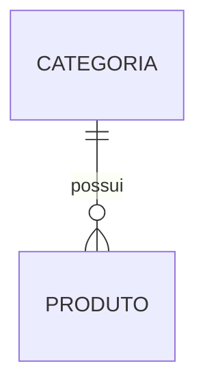

# Aula — Funções de Agregação em Bancos de Dados com PostgreSQL

**Disciplina:** Banco de Dados I  
**Ambiente:** PostgreSQL / Supabase SQL Editor  
**Nível:** básico ao intermediário  
**Pré-requisitos:** `SELECT`, `WHERE`, `ORDER BY`, `LIMIT`, `INSERT` e operadores relacionais e lógicos.  
**Objetivo:** compreender como resumir, agrupar e analisar dados armazenados em tabelas relacionais utilizando SQL.

---

## Parte 1 — Introdução às agregações

### 1. Consultar registros não é o mesmo que analisar dados

Até agora, utilizamos SQL principalmente para recuperar e manipular registros:

```sql
SELECT * FROM produto;

SELECT *
FROM produto
WHERE preco > 100;

SELECT *
FROM produto
ORDER BY preco DESC;
```

Entretanto, um gerente pode perguntar:

- Quantos produtos estão cadastrados?
- Qual é o produto mais caro?
- Qual é o preço médio?
- Qual é o valor total do estoque?
- Quantos produtos existem em cada categoria?
- Quais categorias possuem mais de cinco produtos?

Essas perguntas exigem produzir informações resumidas a partir de conjuntos de registros.

### 2. O que é uma agregação?

Uma agregação utiliza um conjunto de valores para produzir um resultado resumido. Para os valores `100, 200, 300, 400`:

| Operação | Resultado |
|---|---:|
| Quantidade | 4 |
| Soma | 1000 |
| Média | 250 |
| Menor valor | 100 |
| Maior valor | 400 |

As funções fundamentais são:

- `COUNT()` — contagem;
- `SUM()` — soma;
- `AVG()` — média;
- `MIN()` — menor valor;
- `MAX()` — maior valor.

O PostgreSQL também possui `STRING_AGG()`, `ARRAY_AGG()`, `BOOL_AND()`, `BOOL_OR()`, agregações JSON e funções estatísticas.

---

## Parte 2 — Preparando o banco

### 3. Tabela dos exemplos

```text
PRODUTO_AGREGACAO(
    id_produto PK,
    nome,
    categoria,
    preco,
    estoque
)
```

Para facilitar os primeiros exemplos, a categoria está na própria tabela. Em um modelo normalizado, ela seria uma tabela e `produto` teria uma chave estrangeira.

```sql
CREATE TABLE produto_agregacao (
    id_produto BIGINT GENERATED ALWAYS AS IDENTITY PRIMARY KEY,
    nome VARCHAR(100) NOT NULL,
    categoria VARCHAR(50) NOT NULL,
    preco NUMERIC(10,2) NOT NULL CHECK (preco >= 0),
    estoque INTEGER NOT NULL DEFAULT 0 CHECK (estoque >= 0)
);

INSERT INTO produto_agregacao
(nome, categoria, preco, estoque)
VALUES
('Notebook', 'Informática', 3500.00, 5),
('Mouse', 'Informática', 80.00, 20),
('Teclado', 'Informática', 150.00, 15),
('Monitor', 'Informática', 1200.00, 8),
('Cadeira', 'Móveis', 600.00, 10),
('Mesa', 'Móveis', 900.00, 4),
('Armário', 'Móveis', 1500.00, 3),
('Caneta', 'Papelaria', 5.00, 100),
('Caderno', 'Papelaria', 25.00, 50),
('Borracha', 'Papelaria', 3.00, 80);
```

| Produto | Categoria | Preço | Estoque |
|---|---|---:|---:|
| Notebook | Informática | 3500,00 | 5 |
| Mouse | Informática | 80,00 | 20 |
| Teclado | Informática | 150,00 | 15 |
| Monitor | Informática | 1200,00 | 8 |
| Cadeira | Móveis | 600,00 | 10 |
| Mesa | Móveis | 900,00 | 4 |
| Armário | Móveis | 1500,00 | 3 |
| Caneta | Papelaria | 5,00 | 100 |
| Caderno | Papelaria | 25,00 | 50 |
| Borracha | Papelaria | 3,00 | 80 |

---

## Parte 3 — Funções fundamentais

### 4. COUNT() — Contagem

```sql
SELECT COUNT(*)
FROM produto_agregacao;
```

Resultado: `10`.

Com um nome significativo:

```sql
SELECT COUNT(*) AS total_produtos
FROM produto_agregacao;
```

Contagem após filtro:

```sql
SELECT COUNT(*) AS total_informatica
FROM produto_agregacao
WHERE categoria = 'Informática';
```

Resultado: `4`. O `WHERE` filtra antes da contagem.

| Expressão | Comportamento |
|---|---|
| `COUNT(*)` | Conta todas as linhas |
| `COUNT(preco)` | Conta preços não nulos |
| `COUNT(DISTINCT categoria)` | Conta categorias distintas não nulas |

```sql
SELECT COUNT(DISTINCT categoria) AS total_categorias
FROM produto_agregacao;
```

Resultado: `3`. `COUNT(coluna)` não conta `NULL`; `COUNT(*)` conta a linha mesmo que algumas colunas sejam nulas.

### 5. SUM() — Soma

```sql
SELECT SUM(estoque) AS total_unidades
FROM produto_agregacao;
```

Resultado: `295`.

```sql
SELECT SUM(estoque) AS estoque_informatica
FROM produto_agregacao
WHERE categoria = 'Informática';
```

Resultado: `48`.

Para calcular o valor do estoque:

```text
Valor em estoque = preço × quantidade
```

```sql
SELECT SUM(preco * estoque) AS valor_total_estoque
FROM produto_agregacao;
```

Resultado: `47040.00`. `SUM()` aceita expressões. Esse valor usa preços de venda cadastrados; não é necessariamente custo de aquisição ou lucro.

### 6. AVG() — Média aritmética

```text
média = soma dos valores / quantidade de valores
```

```sql
SELECT AVG(preco) AS preco_medio
FROM produto_agregacao;
```

Resultado: `796.30`.

```sql
SELECT AVG(preco) AS preco_medio_informatica
FROM produto_agregacao
WHERE categoria = 'Informática';
```

Resultado: `1232.50`.

Arredondamento:

```sql
SELECT ROUND(AVG(preco), 2) AS preco_medio
FROM produto_agregacao;
```

#### Média simples versus média ponderada

Para A (`preço = 100`, `quantidade = 1`) e B (`preço = 200`, `quantidade = 9`), a média simples é `150`, mas a média ponderada é `190`:

```sql
SELECT
    SUM(preco * estoque) / NULLIF(SUM(estoque), 0)
        AS preco_medio_ponderado
FROM produto_agregacao;
```

`NULLIF()` evita divisão por zero.

### 7. MIN() — Menor valor

```sql
SELECT MIN(preco) AS menor_preco
FROM produto_agregacao;
```

Resultado: `3.00`.

```sql
SELECT MIN(preco) AS menor_preco_moveis
FROM produto_agregacao
WHERE categoria = 'Móveis';
```

Resultado: `600.00`. `MIN()` também pode operar sobre datas e textos, segundo a ordenação do tipo.

`MIN(preco)` retorna o valor, não necessariamente o produto. Para uma única linha de menor preço:

```sql
SELECT nome, preco
FROM produto_agregacao
ORDER BY preco ASC
LIMIT 1;
```

Com empate, `LIMIT 1` mostra apenas uma linha. Para preservar todos os empates:

```sql
SELECT nome, preco
FROM produto_agregacao
WHERE preco = (SELECT MIN(preco) FROM produto_agregacao);
```

### 8. MAX() — Maior valor

```sql
SELECT MAX(preco) AS maior_preco
FROM produto_agregacao;

SELECT MAX(estoque) AS maior_estoque
FROM produto_agregacao;
```

Resultados: `3500.00` e `100`.

```sql
SELECT nome, preco
FROM produto_agregacao
ORDER BY preco DESC
LIMIT 1;
```

Resultado: Notebook, `3500.00`.

```sql
SELECT
    MIN(preco) AS menor_preco,
    MAX(preco) AS maior_preco
FROM produto_agregacao;
```

| menor_preco | maior_preco |
|---:|---:|
| 3,00 | 3500,00 |

---

## Parte 4 — Combinando agregações

### 9. Várias funções em uma consulta

```sql
SELECT
    COUNT(*) AS quantidade_produtos,
    SUM(estoque) AS unidades_estoque,
    ROUND(AVG(preco), 2) AS preco_medio,
    MIN(preco) AS menor_preco,
    MAX(preco) AS maior_preco,
    SUM(preco * estoque) AS valor_estoque
FROM produto_agregacao;
```

Até aqui, cada consulta produziu um único grupo: a tabela inteira ou o conjunto filtrado. Para calcular separadamente por categoria, usamos `GROUP BY`.

---

## Parte 5 — GROUP BY

### 10. Conceito

`GROUP BY` reúne linhas com valores iguais em uma ou mais colunas. Em seguida, as funções de agregação são executadas em cada grupo.

```sql
SELECT
    categoria,
    COUNT(*) AS total_produtos
FROM produto_agregacao
GROUP BY categoria;
```

| categoria | total_produtos |
|---|---:|
| Informática | 4 |
| Móveis | 3 |
| Papelaria | 3 |

Processamento conceitual:

1. lê as linhas;
2. forma grupos de mesma categoria;
3. executa `COUNT(*)` em cada grupo;
4. retorna uma linha por grupo.

A ordem não é garantida sem `ORDER BY`.

### 11. Média por categoria

```sql
SELECT
    categoria,
    ROUND(AVG(preco), 2) AS preco_medio
FROM produto_agregacao
GROUP BY categoria
ORDER BY categoria;
```

| categoria | preco_medio |
|---|---:|
| Informática | 1232,50 |
| Móveis | 1000,00 |
| Papelaria | 11,00 |

```mermaid
xychart-beta
    title "Preço médio por categoria"
    x-axis [Informática, Móveis, Papelaria]
    y-axis "R$" 0 --> 1300
    bar [1232.5, 1000, 11]
```

### 12. Várias agregações por grupo

```sql
SELECT
    categoria,
    COUNT(*) AS total_produtos,
    SUM(estoque) AS unidades,
    ROUND(AVG(preco), 2) AS preco_medio,
    MIN(preco) AS menor_preco,
    MAX(preco) AS maior_preco
FROM produto_agregacao
GROUP BY categoria
ORDER BY categoria;
```

#### Regra do GROUP BY

Esta consulta gera erro:

```sql
SELECT categoria, nome, COUNT(*)
FROM produto_agregacao
GROUP BY categoria;
```

Dentro de cada categoria há vários nomes, e o banco não sabe qual escolher. Retire `nome` ou inclua-o no agrupamento:

```sql
SELECT categoria, nome, COUNT(*)
FROM produto_agregacao
GROUP BY categoria, nome;
```

Essa correção muda a granularidade para uma linha por combinação de categoria e nome. Regra geral: colunas selecionadas fora das funções agregadoras precisam participar do `GROUP BY`, salvo dependências funcionais reconhecidas pelo PostgreSQL.

### Agrupamento por mais de uma coluna

```sql
SELECT categoria, estoque, COUNT(*)
FROM produto_agregacao
GROUP BY categoria, estoque
ORDER BY categoria, estoque;
```

Cada combinação distinta forma um grupo.

---

## Parte 6 — HAVING

### 13. Filtrando resultados agregados

Para descobrir quais categorias possuem mais de três produtos:

```sql
SELECT
    categoria,
    COUNT(*) AS total_produtos
FROM produto_agregacao
GROUP BY categoria
HAVING COUNT(*) > 3;
```

| categoria | total_produtos |
|---|---:|
| Informática | 4 |

### 14. WHERE versus HAVING

| `WHERE` | `HAVING` |
|---|---|
| Filtra linhas antes do agrupamento | Filtra grupos após o agrupamento |
| Atua sobre registros | Pode atuar sobre agregações |
| Não recebe agregações diretamente | Permite `COUNT`, `SUM`, `AVG` etc. |
| Pode ser usado sem `GROUP BY` | Frequentemente acompanha `GROUP BY` |

Produtos acima de R$ 100, mantendo categorias com pelo menos dois desses produtos:

```sql
SELECT categoria, COUNT(*) AS total_produtos
FROM produto_agregacao
WHERE preco > 100
GROUP BY categoria
HAVING COUNT(*) >= 2;
```

Categorias com média acima de R$ 500:

```sql
SELECT
    categoria,
    ROUND(AVG(preco), 2) AS preco_medio
FROM produto_agregacao
GROUP BY categoria
HAVING AVG(preco) > 500
ORDER BY preco_medio DESC;
```

| categoria | preco_medio |
|---|---:|
| Informática | 1232,50 |
| Móveis | 1000,00 |

---

## Parte 7 — Agregações avançadas do PostgreSQL

### 15. STRING_AGG()

Reúne textos de várias linhas em uma string:

```sql
SELECT
    categoria,
    STRING_AGG(nome, ', ' ORDER BY nome) AS produtos
FROM produto_agregacao
GROUP BY categoria;
```

| categoria | produtos |
|---|---|
| Informática | Monitor, Mouse, Notebook, Teclado |
| Móveis | Armário, Cadeira, Mesa |
| Papelaria | Borracha, Caderno, Caneta |

### 16. ARRAY_AGG()

```sql
SELECT
    categoria,
    ARRAY_AGG(nome ORDER BY nome) AS produtos
FROM produto_agregacao
GROUP BY categoria;
```

Para Informática: `{Monitor,Mouse,Notebook,Teclado}`. O resultado é um array PostgreSQL, não uma string.

### 17. BOOL_AND() e BOOL_OR()

- `BOOL_AND()` é verdadeiro quando todos os valores não nulos são verdadeiros.
- `BOOL_OR()` é verdadeiro quando pelo menos um valor não nulo é verdadeiro.

```sql
SELECT
    categoria,
    BOOL_AND(estoque > 0) AS todos_com_estoque,
    BOOL_OR(estoque = 0) AS algum_sem_estoque
FROM produto_agregacao
GROUP BY categoria;
```

Com os dados atuais, o primeiro resultado é verdadeiro e o segundo é falso em todas as categorias.

### 18. Outras funções agregadoras

| Função | Finalidade |
|---|---|
| `STDDEV_SAMP()` | Desvio padrão amostral |
| `VAR_SAMP()` | Variância amostral |
| `CORR()` | Correlação entre duas variáveis |
| `JSON_AGG()` | Agrega valores em array JSON |
| `JSONB_AGG()` | Agrega valores em array JSONB |
| `JSON_OBJECT_AGG()` | Agrega pares chave/valor em objeto JSON |
| `BIT_AND()` | AND bit a bit |
| `BIT_OR()` | OR bit a bit |

Exemplo JSON:

```sql
SELECT
    categoria,
    JSONB_AGG(
        JSONB_BUILD_OBJECT('nome', nome, 'preco', preco)
        ORDER BY nome
    ) AS produtos
FROM produto_agregacao
GROUP BY categoria;
```

---

## Parte 8 — NULL e recursos adicionais

### 19. Tratamento de NULL

`SUM`, `AVG`, `MIN` e `MAX` ignoram valores `NULL`. `COUNT(coluna)` também ignora nulos; `COUNT(*)` conta todas as linhas. Sem valores de entrada, `COUNT()` retorna zero, enquanto as demais agregações normalmente retornam `NULL`.

```sql
SELECT
    COUNT(*) AS total,
    SUM(estoque) AS estoque_total
FROM produto_agregacao
WHERE categoria = 'Categoria Inexistente';
```

| total | estoque_total |
|---:|---:|
| 0 | NULL |

```sql
SELECT COALESCE(SUM(estoque), 0) AS estoque_total
FROM produto_agregacao
WHERE categoria = 'Categoria Inexistente';
```

Resultado: `0`. `COALESCE()` não agrega; retorna o primeiro argumento não nulo.

### 20. FILTER — Agregações condicionais

```sql
SELECT
    COUNT(*) AS total_produtos,
    COUNT(*) FILTER (WHERE preco > 1000) AS produtos_caros,
    COUNT(*) FILTER (WHERE estoque < 10) AS estoque_baixo
FROM produto_agregacao;
```

| total_produtos | produtos_caros | estoque_baixo |
|---:|---:|---:|
| 10 | 3 | 4 |

```sql
SELECT
    SUM(estoque) AS estoque_total,
    SUM(estoque) FILTER (
        WHERE categoria = 'Informática'
    ) AS estoque_informatica
FROM produto_agregacao;
```

`FILTER` calcula indicadores condicionais sem consultas separadas.

### DISTINCT dentro de agregações

```sql
SELECT
    COUNT(categoria) AS ocorrencias,
    COUNT(DISTINCT categoria) AS categorias_distintas
FROM produto_agregacao;
```

Nem toda função aceita todas as combinações de `DISTINCT`, `ORDER BY` e `FILTER`; consulte a assinatura da função utilizada.

---

## Parte 9 — Agregações com relacionamentos

### 21. GROUP BY com JOIN

Em um esquema normalizado:

```text
CATEGORIA(id_categoria PK, nome)
PRODUTO(id_produto PK, nome, preco, estoque, id_categoria FK)
```



Contagem apenas das categorias com produtos:

```sql
SELECT
    c.id_categoria,
    c.nome AS categoria,
    COUNT(*) AS total_produtos
FROM categoria c
INNER JOIN produto p
    ON p.id_categoria = c.id_categoria
GROUP BY c.id_categoria, c.nome
ORDER BY c.nome;
```

Incluindo categorias sem produtos:

```sql
SELECT
    c.id_categoria,
    c.nome AS categoria,
    COUNT(p.id_produto) AS total_produtos
FROM categoria c
LEFT JOIN produto p
    ON p.id_categoria = c.id_categoria
GROUP BY c.id_categoria, c.nome
ORDER BY c.nome;
```

#### Por que não COUNT(*) no LEFT JOIN?

Uma categoria sem produto ainda produz uma linha no resultado externo. `COUNT(*)` contaria essa linha como 1. `COUNT(p.id_produto)` ignora o `NULL` do lado direito e retorna corretamente 0.

Outros indicadores:

```sql
SELECT
    c.id_categoria,
    c.nome AS categoria,
    COUNT(p.id_produto) AS produtos,
    COALESCE(SUM(p.estoque), 0) AS unidades,
    ROUND(AVG(p.preco), 2) AS preco_medio,
    COALESCE(SUM(p.preco * p.estoque), 0) AS valor_estoque
FROM categoria c
LEFT JOIN produto p
    ON p.id_categoria = c.id_categoria
GROUP BY c.id_categoria, c.nome
ORDER BY c.nome;
```

`AVG()` permanece `NULL` para categorias vazias, o que expressa “não existe média”. Substituí-la por zero é uma decisão semântica, não apenas técnica.

---

## Parte 10 — Ordem lógica de uma consulta agregada


Exemplo:

```sql
SELECT
    categoria,
    COUNT(*) AS quantidade
FROM produto_agregacao
WHERE preco > 100
GROUP BY categoria
HAVING COUNT(*) >= 2
ORDER BY quantidade DESC
LIMIT 5;
```

Leitura conceitual:

1. obtém as linhas de `produto_agregacao`;
2. preserva as que têm preço acima de 100;
3. agrupa por categoria;
4. mantém os grupos com pelo menos duas linhas;
5. calcula e apresenta as colunas do `SELECT`;
6. ordena pela quantidade;
7. limita a cinco linhas.

Essa é a ordem lógica simplificada; o otimizador do PostgreSQL pode escolher outra ordem física sem alterar o resultado.

---

## Parte 11 — Erros comuns e soluções

### 22. Selecionar uma coluna sem agrupá-la

```sql
-- Incorreto
SELECT categoria, nome, COUNT(*)
FROM produto_agregacao
GROUP BY categoria;
```

Solução: remova `nome`, agregue-o (`STRING_AGG`, por exemplo) ou inclua-o no `GROUP BY`, consciente da mudança de granularidade.

### 23. Usar agregação em WHERE

```sql
-- Incorreto
SELECT categoria, COUNT(*)
FROM produto_agregacao
WHERE COUNT(*) > 3
GROUP BY categoria;
```

```sql
-- Correto
SELECT categoria, COUNT(*)
FROM produto_agregacao
GROUP BY categoria
HAVING COUNT(*) > 3;
```

### 24. Confundir contagem de linhas com contagem de valores

Escolha entre `COUNT(*)`, `COUNT(coluna)` e `COUNT(DISTINCT coluna)` de acordo com a pergunta. Em junções externas, prefira contar a chave não nula do lado opcional.

### 25. Calcular média das médias

Se grupos têm tamanhos diferentes, a média simples das médias não é a média global. Use soma e contagem:

```text
média global = soma de todos os valores / quantidade total
```

Para combinar médias previamente calculadas, faça uma média ponderada pelas contagens de cada grupo.

### 26. Divisão inteira

Dependendo dos tipos envolvidos, uma divisão pode descartar casas decimais. Converta para `numeric` quando necessário:

```sql
SELECT SUM(estoque)::numeric / NULLIF(COUNT(*), 0)
FROM produto_agregacao;
```

### 27. Ignorar NULL

Uma média ignora `NULL`; isso é diferente de tratar o valor como zero. Use `COALESCE(coluna, 0)` dentro da agregação somente quando zero for o significado correto para o domínio.

### 28. Agrupar em granularidade errada

Antes de escrever SQL, defina: “cada linha do resultado representa o quê?”. Se a resposta for “uma categoria”, agrupe por categoria; se for “uma categoria por mês”, agrupe por ambos.

---

## Parte 12 — Datas e relatórios periódicos

O PostgreSQL permite agrupar datas com `DATE_TRUNC()`:

```sql
SELECT
    DATE_TRUNC('month', data_pedido)::date AS mes,
    COUNT(*) AS pedidos,
    SUM(valor_total) AS faturamento
FROM pedido
GROUP BY DATE_TRUNC('month', data_pedido)
ORDER BY mes;
```

Por ano:

```sql
SELECT
    EXTRACT(YEAR FROM data_pedido) AS ano,
    COUNT(*) AS pedidos
FROM pedido
GROUP BY EXTRACT(YEAR FROM data_pedido)
ORDER BY ano;
```

Agrupe pela mesma expressão exibida, ou use uma subconsulta/CTE para nomeá-la.

---

## Parte 13 — Desempenho e boas práticas

- Filtre cedo com `WHERE` quando o filtro pertence às linhas individuais.
- Use tipos numéricos adequados; para dinheiro, `NUMERIC` evita imprecisões binárias de ponto flutuante.
- Índices em colunas de filtro e junção podem ajudar, mas agregações que leem grande parte da tabela ainda podem exigir varreduras extensas.
- Índices não substituem uma consulta correta. Verifique planos com `EXPLAIN` e `EXPLAIN ANALYZE` em ambiente seguro.
- Evite selecionar colunas que não participam da análise.
- Dê aliases significativos às métricas.
- Documente unidade e significado: “receita bruta”, “quantidade de pedidos” e “ticket médio” não são intercambiáveis.
- Para relatórios caros e frequentes, considere views, views materializadas ou tabelas de resumo, avaliando atualização e consistência.

Exemplo de `EXPLAIN`:

```sql
EXPLAIN
SELECT categoria, COUNT(*)
FROM produto_agregacao
GROUP BY categoria;
```

---

## Parte 14 — Exercícios

### Nível 1 — Funções básicas

1. Conte todos os produtos.
2. Conte as categorias distintas.
3. Calcule o total de unidades em estoque.
4. Calcule o valor financeiro total do estoque.
5. Calcule o preço médio.
6. Encontre o menor e o maior preço.
7. Mostre todos os produtos empatados no menor preço.

### Nível 2 — GROUP BY

8. Conte os produtos por categoria.
9. Calcule o estoque total por categoria.
10. Calcule preço médio, mínimo e máximo por categoria.
11. Calcule o valor financeiro do estoque por categoria.
12. Liste alfabeticamente os produtos de cada categoria em uma string.

### Nível 3 — WHERE, HAVING e FILTER

13. Conte por categoria somente produtos com preço acima de R$ 100.
14. Mostre categorias com pelo menos três produtos.
15. Mostre categorias com preço médio acima de R$ 500.
16. Em uma linha, conte todos os produtos, os de preço acima de R$ 1000 e os com estoque abaixo de 10.
17. Mostre categorias cujo valor total de estoque supera R$ 10.000.

### Nível 4 — JOIN e agregação

18. Em um esquema normalizado, conte produtos por categoria incluindo categorias vazias.
19. Mostre somente categorias vazias.
20. Calcule quantidade, média e valor do estoque por categoria.
21. Explique por que `COUNT(*)` pode dar resultado incorreto em um `LEFT JOIN`.

### Desafio

22. Modele `cliente`, `pedido` e `item_pedido`. Produza:

    a. total de pedidos por cliente, incluindo clientes sem pedidos;
    b. valor total de cada pedido;
    c. total gasto por cliente;
    d. ticket médio por cliente;
    e. clientes com total gasto acima de R$ 1.000;
    f. produto mais vendido por quantidade, preservando empates.

---

## Parte 15 — Soluções sugeridas

```sql
-- 1
SELECT COUNT(*) AS total_produtos FROM produto_agregacao;

-- 2
SELECT COUNT(DISTINCT categoria) AS categorias
FROM produto_agregacao;

-- 3
SELECT SUM(estoque) AS unidades FROM produto_agregacao;

-- 4
SELECT SUM(preco * estoque) AS valor_estoque
FROM produto_agregacao;

-- 5
SELECT ROUND(AVG(preco), 2) AS preco_medio
FROM produto_agregacao;

-- 6
SELECT MIN(preco), MAX(preco) FROM produto_agregacao;

-- 7
SELECT nome, preco
FROM produto_agregacao
WHERE preco = (SELECT MIN(preco) FROM produto_agregacao);

-- 8
SELECT categoria, COUNT(*) AS produtos
FROM produto_agregacao GROUP BY categoria;

-- 9
SELECT categoria, SUM(estoque) AS unidades
FROM produto_agregacao GROUP BY categoria;

-- 10
SELECT categoria,
       ROUND(AVG(preco), 2) AS media,
       MIN(preco) AS minimo,
       MAX(preco) AS maximo
FROM produto_agregacao
GROUP BY categoria;

-- 11
SELECT categoria, SUM(preco * estoque) AS valor_estoque
FROM produto_agregacao
GROUP BY categoria;

-- 12
SELECT categoria, STRING_AGG(nome, ', ' ORDER BY nome) AS produtos
FROM produto_agregacao
GROUP BY categoria;

-- 13
SELECT categoria, COUNT(*)
FROM produto_agregacao
WHERE preco > 100
GROUP BY categoria;

-- 14
SELECT categoria, COUNT(*)
FROM produto_agregacao
GROUP BY categoria
HAVING COUNT(*) >= 3;

-- 15
SELECT categoria, ROUND(AVG(preco), 2)
FROM produto_agregacao
GROUP BY categoria
HAVING AVG(preco) > 500;

-- 16
SELECT COUNT(*) AS total,
       COUNT(*) FILTER (WHERE preco > 1000) AS caros,
       COUNT(*) FILTER (WHERE estoque < 10) AS estoque_baixo
FROM produto_agregacao;

-- 17
SELECT categoria, SUM(preco * estoque) AS valor
FROM produto_agregacao
GROUP BY categoria
HAVING SUM(preco * estoque) > 10000;

-- 18
SELECT c.id_categoria, c.nome,
       COUNT(p.id_produto) AS produtos
FROM categoria c
LEFT JOIN produto p ON p.id_categoria = c.id_categoria
GROUP BY c.id_categoria, c.nome;

-- 19
SELECT c.id_categoria, c.nome
FROM categoria c
LEFT JOIN produto p ON p.id_categoria = c.id_categoria
GROUP BY c.id_categoria, c.nome
HAVING COUNT(p.id_produto) = 0;

-- 20
SELECT c.id_categoria, c.nome,
       COUNT(p.id_produto) AS produtos,
       ROUND(AVG(p.preco), 2) AS media,
       COALESCE(SUM(p.preco * p.estoque), 0) AS valor_estoque
FROM categoria c
LEFT JOIN produto p ON p.id_categoria = c.id_categoria
GROUP BY c.id_categoria, c.nome;
```

Para o desafio, supondo `item_pedido(id_pedido, id_produto, quantidade, preco_unitario)`:

```sql
-- a) pedidos por cliente
SELECT c.id_cliente, c.nome, COUNT(p.id_pedido) AS pedidos
FROM cliente c
LEFT JOIN pedido p ON p.id_cliente = c.id_cliente
GROUP BY c.id_cliente, c.nome;

-- b) valor de cada pedido
SELECT p.id_pedido,
       COALESCE(SUM(i.quantidade * i.preco_unitario), 0) AS total
FROM pedido p
LEFT JOIN item_pedido i ON i.id_pedido = p.id_pedido
GROUP BY p.id_pedido;

-- c, d e e) total e ticket médio por cliente
WITH totais_pedido AS (
    SELECT p.id_pedido, p.id_cliente,
           COALESCE(SUM(i.quantidade * i.preco_unitario), 0) AS total
    FROM pedido p
    LEFT JOIN item_pedido i ON i.id_pedido = p.id_pedido
    GROUP BY p.id_pedido, p.id_cliente
)
SELECT c.id_cliente, c.nome,
       COUNT(t.id_pedido) AS pedidos,
       COALESCE(SUM(t.total), 0) AS total_gasto,
       ROUND(AVG(t.total), 2) AS ticket_medio
FROM cliente c
LEFT JOIN totais_pedido t ON t.id_cliente = c.id_cliente
GROUP BY c.id_cliente, c.nome
HAVING COALESCE(SUM(t.total), 0) > 1000;

-- f) produto(s) mais vendido(s), preservando empates
WITH vendas AS (
    SELECT id_produto, SUM(quantidade) AS quantidade
    FROM item_pedido
    GROUP BY id_produto
), classificados AS (
    SELECT *, DENSE_RANK() OVER (ORDER BY quantidade DESC) AS posicao
    FROM vendas
)
SELECT p.nome, c.quantidade
FROM classificados c
JOIN produto p ON p.id_produto = c.id_produto
WHERE c.posicao = 1;
```

---

## Parte 16 — Síntese

| Recurso | Pergunta respondida |
|---|---|
| `COUNT()` | Quantos? |
| `SUM()` | Qual é o total? |
| `AVG()` | Qual é a média? |
| `MIN()` | Qual é o menor valor? |
| `MAX()` | Qual é o maior valor? |
| `GROUP BY` | Qual é o resultado para cada grupo? |
| `HAVING` | Quais grupos atendem à condição? |
| `FILTER` | Como calcular métricas condicionais na mesma consulta? |
| `STRING_AGG()` | Como reunir textos? |
| `ARRAY_AGG()` | Como reunir valores em um array? |

O aluno deve compreender que:

- uma agregação transforma várias linhas em um resultado resumido;
- sem `GROUP BY`, toda a entrada forma um grupo;
- com `GROUP BY`, cada combinação de chaves forma um grupo;
- `WHERE` filtra linhas e `HAVING` filtra grupos;
- `NULL` não equivale a zero;
- a granularidade deve ser definida antes da consulta;
- `JOIN` ocorre logicamente antes do agrupamento;
- em junções externas, a escolha da expressão contada é essencial;
- médias ponderadas, somas de expressões e tratamento de divisões exigem atenção ao significado do indicador.

Agregações são fundamentais para relatórios, dashboards, indicadores, auditorias, análises estatísticas e apoio à decisão.

---

## Referências

- PostgreSQL Global Development Group. [PostgreSQL — Aggregate Functions](https://www.postgresql.org/docs/current/functions-aggregate.html).
- PostgreSQL Global Development Group. [PostgreSQL — SELECT](https://www.postgresql.org/docs/current/sql-select.html).
- PostgreSQL Global Development Group. [PostgreSQL — Table Expressions](https://www.postgresql.org/docs/current/queries-table-expressions.html).
- ELMASRI, R.; NAVATHE, S. B. *Sistemas de Banco de Dados*.
- SILBERSCHATZ, A.; KORTH, H. F.; SUDARSHAN, S. *Sistema de Banco de Dados*.

